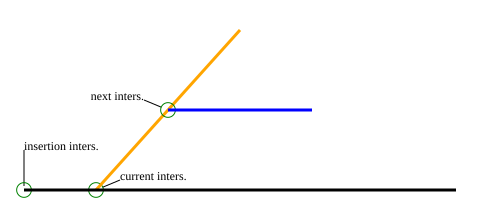

# Pathfind algorithm

The following describes the ideas behind the pathfinding algorithm (`pathfind`) in
[the main file](../main.jl). The method there also has extensive comments detailing
what is happening at each step.

## Data

Used datasets (see [data.jl](../src/data.jl) for where to put; generally in
[the data folder](../data/)):

https://suomenvaylat.vayla.fi/, on the left in "Karttatasot ja -aineistot":
* Tieosoiteverkko, hallinnollinen luokka Elinvoimakeskus 1.1.2026 (in "Tiestötiedot")

https://asiointi.maanmittauslaitos.fi/karttapaikka/?lang=en:
* https://asiointi.maanmittauslaitos.fi/karttapaikka/tiedostopalvelu/hallinnolliset_aluejaot_vektori?lang=en
    * 1:10000 and 1:450000 (though the former is somewhat unnecessary, only being
    used for the country vector data); ESRI shapefile format
* https://asiointi.maanmittauslaitos.fi/karttapaikka/tiedostopalvelu/nimisto?lang=en
    * Place names, simplified; GML format


The data used for the pathfind algorithm here consists of real road data
(polylines), synthetic intersection data calculated based on the geometric
intersection points of the road (points), and the location data
of various places (points). The most important of these are the intersections.

### Intersections

In part due to the synthetic nature of the intersection data, it's not entirely
accurate. For one, it currently only considers two-dimensional overlap of roads,
meaning that an overpass would be considered to have an intersection with the
road going under it. Second, distances between intersections, something
that is used to calculate the total path length of a path, are calculated
as linear distance between the two, which can be inaccurate. However,
the focus is on the pathfinding algorithm itself being functional. As such,
whether intersections or the distances between them are accurate is not particularly important;
what is important is whether the algorithm can optimise correctly based on
the data it's given, regardless of whether that data is entirely descriptive
of reality. If the algorithm can optimise correctly, the only change needed
to make it usable in practice (apart from considerations of time-to-near-optimal-path etc.)
would be to give it correct intersections and
correct distance between those intersections. This is merely a matter of
changing the data that is handed to the algorithm, something that
the algorithm itself doesn't need to know about.

### Road data and place locations

The real road data is mainly used to find start and end roads, as well
as visualise the path once it is found. Intersections are matched with
the roads they belong to, allowing the roads to be easily found once
that pathfinding is done.

Place locations are used as the proper start and end points of the path.
They are also used for calculating remaining distances, or the directionality
of a given path segment, which can be used for scoring path segments (see
below).

## Concepts

The following sections go over the broad ideas of the algorithm. [Further down](#algorithm),
the algorithm is described in a more technical way.

### Storing paths

The paths may be stored in a table format: the current point in the path is
stored in an ID $I_c$, and the parent ID is stored in $I_p$. Together,
this ID combination creates a path segment. The path thus far from any point
can be found by

1. Store current ID $I_c$.
2. Get parent's ID $I_p$.
3. Use parent's ID $I_p$ to find previous segment, the row(s) where $I_c = I_p$.
4. If there are multiple possibilities for the previous segment, choose
The "best" one (e.g. shortest path length up to that point).
5. Repeat 1-4 until no parent ID found (start location/road is added to the table
intentionally without a parent for this purpose).
6. Reverse vector of found IDs to find road IDs from start to finish.

### Finding the first path

The pathfinding process starts at the start road, usually the road closest
to the start location, potentially also in the direction of the destination.
From any given road, all intersections of that road are considered (call these *current*
(considered) intersections), in relation to some *insertion* intersection of that road: we
are arriving onto the road from some intersection, and want to find the
intersection to leave the road from. Because the aim is to start
heading towards the destination, the *next* intersections of the
roads of the current intersections are also checked: for all the intersections
on the current road, find the intersection that would best lead us
toward the destination; current to next intersection gives the direction
that we would be heading from the current intersection, and the best choice
of current intersection would be the one for which a next intersection
gets us best towards our destination.



#### Score function

Multiple ways could be used to determine which next path segment is the most
optimal, such as how much closer that segment gets us towards our destination,
how directly towards our destination the path segment goes, or — if that
information was available — what is the speed limit on the path segment.
Further thought into any of these options reveals that none of them are
entirely ideal: the segment that gets us closest to our destination might
also be an unnecessary long segment, taking us down a winding path
which ends up extending the length of our trip; choosing the segment that
goes most directly towards our destination might take us also along a
winding path which zig-zags along the most direct routes; and choosing
the path segment with the highest speed limit might take us far away
from the destination at times.

With the segment that gets us closest to our destination, if we considered
also the length of the segment and instead valued segments whose approach
was greatest considering the segment's length, we would limit the problem
described earlier. Dividing the segment length by the approach would give
us a more useful metric to base comparison of segments on. If the speed
limit of segments were available, these details could be joined into
one metric, with higher speed limit segments being weighted more.

To allow different metrics to be used to calculate the optimality of
path segments, a score function is used. This function is opaque to the
pathfinding algorithm itself: it only needs to pass in information
about the path segments it's considering, and it will get a score for
each of the path segments. The score function would receive as much useful
information as possible, and would choose to use some subset of that
information to calculate the score. By convention, this score will be
greater the more optimal the path segment.

Using score functions allows the pathfinding algorithm to be changed on
the fly, in a sense anyway, by simply passing it a different score function.
It also allows various metrics to be combined into one easily, and the
influence of each metric to be tweaked easily until a good balance is found.

### Keeping track of path length

It would be ideal to keep track of path length as a path is traced.
This would allow easily tracking back through to find the most optimal
path in the end, as well as using the path length during the algorithm's
operation as described above. This is fine when moving through once, as the distance
travelled between each step can be summed to get the path, at least
approximately. The path length can be kept track of for each step.

When starting another pathfinding process from a given road,
the intersections of that road may or may not have been checked
already: there might be intersections that lead to that road, and if one of
those has already been taken, the road's own intersections would already
have been processed, but with a total path length up to those points that
could be longer than for the current situation. The path length of each should be replaced by
the current total path's path length (up to the segment)
plus the distance, should that value be less than the existing path length
recorded for each further point. This should be repeated for any points that
have been further checked. This way, if a shorter path from the start to
any road is found, that new path length gets propagated down from
that road.

### Finding further paths

Once one path has been found, we have a comparison point. Whatever the
length $L_0$ of the path, the aim would be to find a better path.

During the pathfinding process, multiple partial paths have been found:
at each intersection $I_i$ in the pathfinding, all further connecting
intersections $I_{ij}$ have been scored, though only the best ("best" according
to the used score function) has been used to continue the path. As we're
now aware of the currently optimal $L_{\text{min}} = L_0$, we can try and
find paths that could reasonably be shorter than this. Considering partial
paths that have distance $D$ to the destination and
current path length $l$, one example would be to continue pathfinding on paths
where
```math
kD + l \leq cL_{\text{min}},
```
looking always at the path whose $S \equiv kD + l$ is smallest. In words, the aim
is to test paths for which the *expected* final path length
$S$ would be shorter than the shortest path found. As the distance
$D$ to the destination would be calculated as a direct "beeline" distance,
the coefficient $k \geq 1$ can be used to give a more accurate actual distance.
The coefficient $c \geq 1$ allows further leniency in how close to the current
shortest path length the expected path length needs to be.

Due it its intention as a multiplier to allow the representation of the
expected path length, a more dynamic function of $D$ with $k$ as parameter could be used instead.
For example, $D^k$ with $k \geq 1$ could allow encoding the relative
uncertainty in the remaining expected distance, or $\mathrm{max}(D^k, D)$
to account for the unphysical nature in case of $D < 1$, though this is
a minor issue.

### Preventing infinite loops

When a path is being traced, it is necessary to ensure that the same
roads aren't traversed in such a way that results in a loop in the
algorithm. The simple way to avoid such problems is to keep track of the
intersections traversed thus far and avoiding processing those again,
essentially what was discussed in relation to [updating the path lengths](#keeping-track-of-path-length).
This means that if an intersection that has been processed already is
encountered again in a looping manner, it is ignored and instead the next
best intersection is tested. 

## Algorithm

This section describes the `pathfind` algorithm found in [the main file](../main.jl)
in more technical detail, but in a more succinct form than the code itself.
A few general things:

1. The algorithm attempts to find **the shortest path** between two locations.
This is because the data
available does not include speed limits for roads. If it did, it would be
possible to also focus on the shortest time to reach a location. It *would*
be possible to penalise having many turns in the path — which would manifest as
penalising short distances between intersections — as this could also
be considered to increase the time to reach a destination, even assuming
the same speed limit on every road.

2. Emphasis is put on **finding paths quickly**. The intent is for the algorithm
to be feasible in a navigation setting, where it shouldn't take too long
to find good paths. As such, a balance is being struck between time-per-iteration
and finding good paths.

### Finding the first path

1. The road closest to the start location is chosen. To help with the
algorithm being more consistent, the start location is made a
pseudo-intersection of the start road.

2. The intersections of the current road are found. Because a given road
could have multiple intersections with another road, one intersection
of each intersecting road is taken, based on the insertion intersection
and the distance to the intersection with the intersecting road.

3. The next intersections (intersections of the intersecting roads) are
found. (see [the image](#finding-the-first-path) for a visualisation of 
the intersections). Similarly as in step 2, the closest next intersections
are chosen.

4. Based on the start and destination location, as well as
the calculated current and next intersections, the score is calculated,
see [scoring.jl](../src/scoring.jl). This calculation currently
involves a mixture of the ratio of the path length and the approach distance
as the main metric, weighting by the directness of the approach using
cosine similarity, and weighting by a function of the approach distance
as this information can be somewhat lost in the division. Naturally, these values are also
transformed further to get them to a more numerically ideal form, and to
importantly satisfy the requirement that more optimal paths have a
higher score (although this is in fact not entirely satisfied as the ratio
is somewhat capped to deal with the problem of very large values, especially
with possible infinities).

5. The current intersections are put in order based on the best calculated
score for their next intersections, and added to the end of a table of
seen and/or processed intersections. The intersections with the best scores
are put at the end of the table.

6. This process is repeated starting from step 2 until the calculated
destination intersection is found. This happens by working backwards (i.e. starting
at the last row of the table) through the table of intersections: if the currently considered intersection's children
have already been "checked" (the above process has already been performed on it), an update
is performed recursively on its children's path lengths
[as described earlier](#keeping-track-of-path-length). If the currently
considered intersection has not yet been checked, the process continues
from step 2. Once the destination intersection is found, the total path
length up to it is recorded, and the algorithm changes slightly; see
next section. The destination intersection is likewise a
pseudo-intersection, as it is the destination location rather than an
actual intersection of any road.

### Finding further paths

Once a path has been found, the algorithm changes slightly. Instead
of checking the intersections table (see previous section) in the order
it is in, the table is sorted in order of approximate expected length
to the target weighted by the score of the particular intersection; emphasis
is put on short path lengths. Using this ordering *before* the first path
has been found to not work too well, presumably as too much
emphasis is put on either roads that are further away or closer to the
destination, depending on the particular definition of the approximate
distance. However, after the path has been found, this method allows
searching along the existing paths more effectively, rather than being
stuck closer to the destination (as that is where the roads furthest
down the intersection table would otherwise be).

### Optimisations

A few optimisations that affect the algorithm are also present. These
optimisations aim to strike a balance between speed of execution and
ability to find the optimal route.

#### Culling intersections with poor expected length

Intersections that don't fulfill [the inequality presented earlier](#finding-further-paths)
are completely dropped periodically. This helps keep the size of the table
of intersections smaller, speeding up execution speed. While this could
remove useful intersections, it has in fact been found to improve the
iteration-wise speed at which better paths are found. It may still be that
the most optimal path is lost due to this culling, but the focus is regardless
on finding good paths fast, rather than finding the most optimal path.

The current choice of parameters for the culling decision, $k = 1$ and
$c = 1.02$, has been chosen based on some quick informal testing. $c$ should
be as small as possible considering the limitation of $c \geq 1$, while
not hindering performance too much otherwise. Where $c=1$ and similar
values caused the pathfinding to often end prematurely, large values
of $c$ naturally meant that fewer intersections would be culled. $1.02$
seemed to strike a good balance, with good culling of intersections while
allowing the pathfinding to still continue and even improving the iteration-wise
speed of finding solutions, as mentioned. Changing $k$ would put more emphasis
on the remaining distance compared to the path length thus far, which has
not been found to be particularly useful. $k$ also needs to be kept small
enough so that intersections of the current shortest path aren't culled so
the path can actually be recovered. As a result, $k$ has been kept at $1$.

#### Culling unused intersections

The number of unchecked intersections can grow considerably during the
process, Even with the above culling method in effect.
To combat the degradation of performance caused by the larger
table size that this requires, if the number of unchecked intersections
grows large enough, a set percentage of the lowest scoring ones are dropped.
Unlike [the culling of poor intersections](#culling-intersections-with-poor-expected-length),
this won't help with iteration-wise speed of finding better paths, but
it does allow the algorithm to be run faster per-iteration, on average.
It also shouldn't too much affect finding good paths otherwise, as long
as the parameters are kept lenient enough.

## Miscellaneous notes

* Currently, the code is in prototyping/testing setup, meaning that there
are things that might be unnecessary for a practical setup, such as
extra columns in tables, that can slow down the performance of the
algorithm. In general, the code undoubtedly has various
optimisations that could be performed.
* Multi-processing? Not that parallelisable as-is. Could use a genetic
algorithm, probably, with some randomness of path choices, maybe different
score functions even.